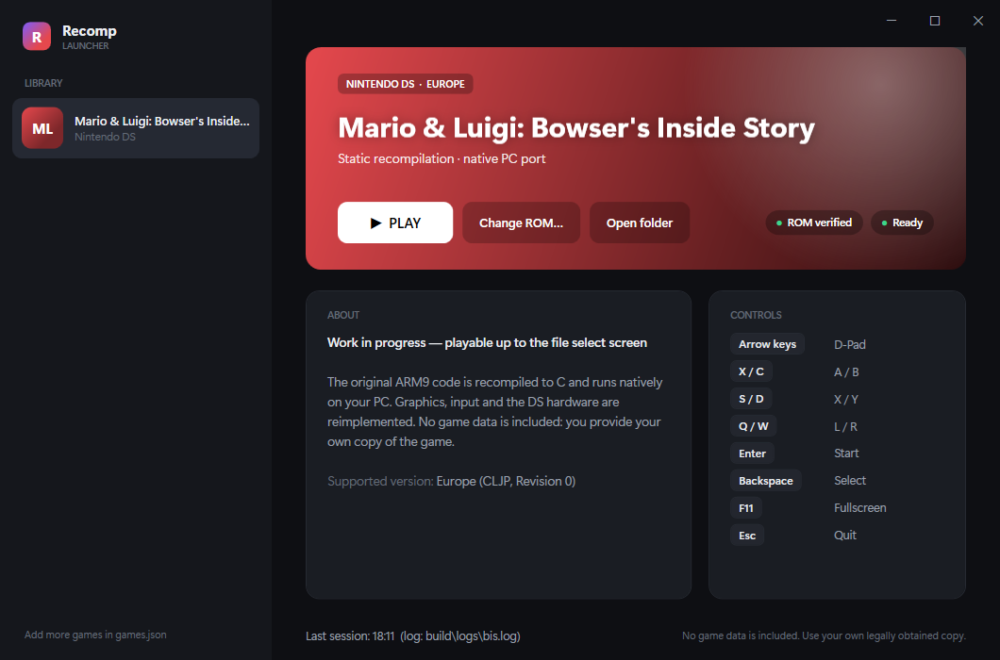

# bis-recomp

A native PC port of **Mario & Luigi: Bowser's Inside Story** (Nintendo DS), built through
**static recompilation**: the game's ARM9 machine code is translated to C, compiled for the PC
and linked against a platform layer that reimplements the DS hardware (graphics, input, timers,
card, the ARM7 co-processor, …).

> **Status: early work in progress.** The game boots, shows the intro, the title screen and the
> file select screen (fully rendered, including 3D), and reacts to keyboard input. Starting a new
> game does not work yet. There is no sound yet.

**This repository contains no game data.** You need your own copy of the game.

## Features so far

- Own ARM → C recompiler (`recomp/recomp.py`) working on the output of
  [dsd](https://github.com/AetiasHax/ds-decomp); 99.6 % of the ~12,200 functions translate fully
- Runtime with a deterministic thread scheduler (SDK threads run as fibers), interrupts, DMA,
  hardware divider/sqrt, card bus and VRAM banking
- ARM7 replacement (card/save, RTC, touch, sound command acknowledgement)
- 2D renderer (text backgrounds, sprites, blending, master brightness)
- Software 3D renderer (matrix stack, clipping, lighting, all 7 texture formats, alpha, Z/W buffer)
- SDL3 window at 60 fps with keyboard controls
- Unit tests for tricky recompiler cases (computed jumps, multi-entry functions, 64-bit division)
- **Recomp Launcher**: a small game launcher that checks your ROM and starts the game

## Supported version

| Field | Value |
|---|---|
| Region | Europe (En, Fr, De, Es, It) |
| Game code | `CLJP` |
| Revision | 0 |
| SHA-1 | `5F35BFBF79A0947740795DD770D99E8EEA3AC85E` |

## Recomp Launcher



`RecompLauncher.exe` lists the available games, verifies your ROM (SHA-1), copies it to where the
port expects it, runs one-time setup steps (extracting the game data) and starts the game. Game
output is written to `build/logs/<game>.log`.

Build it with:

```
launcher\build.bat
```

It uses the C# compiler and WPF that ship with Windows (.NET Framework 4.x), so no SDK is needed.
The result is `RecompLauncher.exe` in the repository root.

### Adding games

Games are described in `launcher/games.json` (copied next to the executable by `build.bat`).
Each entry looks like this:

```json
{
  "id": "bis",
  "title": "Mario & Luigi: Bowser's Inside Story",
  "subtitle": "Static recompilation · native PC port",
  "platform": "Nintendo DS",
  "region": "Europe",
  "accent": "#E5484D",
  "status": "Work in progress",
  "description": "Shown in the About card.",
  "rom": { "label": "Europe (CLJP, Revision 0)", "sha1": "…", "filter": "Nintendo DS ROM (*.nds)|*.nds", "target": "orig/baserom.nds" },
  "setup": [ { "label": "Extracting game data", "exe": "tools/dsd.exe", "args": "rom extract --rom \"{rom}\" --output-path extract/eur", "skipIfExists": "extract/eur/arm9/arm9.bin" } ],
  "launch": { "exe": "build/pc/bis_pc.exe", "args": "extract/eur", "buildHint": "Shown when the executable is missing." },
  "controls": [ ["Arrow keys", "D-Pad"], ["X / C", "A / B"] ]
}
```

Paths are relative to the launcher folder. `{rom}` expands to the absolute ROM target path.
Arguments that name an existing file or folder are passed as absolute paths.

## Building the game

Requirements (placed in `tools/`, not committed):

- [w64devkit](https://github.com/skeeto/w64devkit) (GCC for Windows) in `tools/w64devkit`
- [Ninja](https://ninja-build.org/) as `tools/ninja.exe`
- [dsd](https://github.com/AetiasHax/ds-decomp) as `tools/dsd.exe`
- [SDL 3](https://github.com/libsdl-org/SDL/releases) (MinGW build) in `tools/SDL3-<version>`
- Python 3

Steps:

1. Put your ROM at `orig/baserom.nds` (or select it in the launcher).
2. Extract it: `tools\dsd.exe rom extract --rom orig\baserom.nds --output-path extract\eur`
3. Build and run the PC version: `recomp\runtime\run_pc.bat`
4. Optional: run the tests with `recomp\test\run_tests.bat`

A headless build for debugging renders PNG frames to `build/frames` and prints a detailed
report: `recomp\runtime\run_boot.bat <frames> <memory-access budget in millions>`.

## Controls

| Key | DS |
|---|---|
| Arrow keys | D-Pad |
| X / C | A / B |
| S / D | X / Y |
| Q / W | L / R |
| Enter / Backspace | Start / Select |
| F11 / Esc | Fullscreen / Quit |

## How it works

1. **dsd** splits the ROM into the main program and its 141 overlays and finds function
   boundaries, symbols and relocations (`config/eur`).
2. **recomp.py** translates every ARM function into a C function operating on a shared CPU
   context. Indirect calls go through a function table; functions in overlays that share an
   address are resolved at runtime by checking which overlay is loaded.
3. The **runtime** (`recomp/runtime`) provides memory, I/O registers, DMA, interrupts, the thread
   scheduler, the ARM7 replacement, the card, VRAM, the 2D and 3D renderers and the SDL frontend.
   Every hardware replacement is reported as ORIGINAL (same behaviour), SIMULATED (simplified) or
   MISSING.

Detailed development notes (currently in German) are in [`docs/`](docs): boot process, threads,
ARM7, graphics, recompiler and copy protection.

## Roadmap

- [x] Recompiler, runtime, threads, card access
- [x] 2D and 3D rendering, SDL window, keyboard input
- [x] Title screen and file select screen
- [x] Launcher
- [ ] Start a new game (card timing during streaming loads)
- [ ] Touch screen via mouse, controller support
- [ ] Sound
- [ ] Remaining 3D features (shadows, fog, edge marking, anti-aliasing)
- [ ] First playable version

## Legal

This project does not contain any code or data from the original game. The recompiled C code is
generated locally from your own ROM and is never committed. Mario & Luigi: Bowser's Inside Story
is a trademark of Nintendo. This project is not affiliated with or endorsed by Nintendo.
